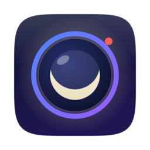
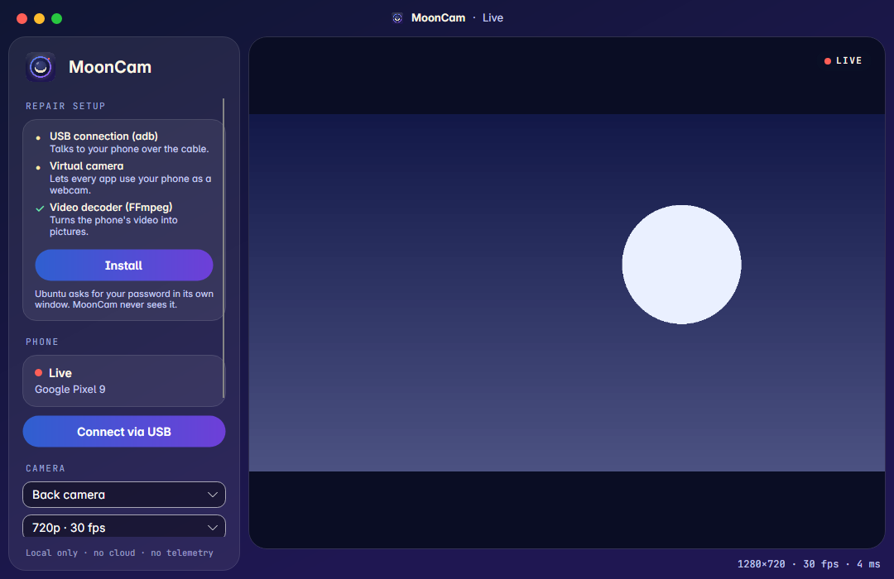
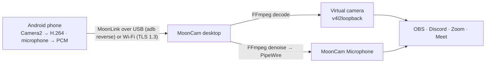

<p align="center">
  
</p>

<h1 align="center">MoonCam</h1>

<p align="center"><b>Your Android phone as a webcam and noise-cancelled microphone for Linux.</b><br>
Over USB or Wi-Fi. Local only: no cloud, no account, no telemetry.</p>

<p align="center">
  <a href="https://jdswe.github.io/MoonCam/"><b>Website</b></a> ·
  <a href="https://github.com/jdswe/MoonCam/releases/latest"><b>Download</b></a> ·
  <a href="docs/roadmap.md">Roadmap</a> ·
  <a href="PRIVACY.md">Privacy</a>
</p>

<p align="center">
  <a href="https://github.com/jdswe/MoonCam/actions/workflows/ci.yml"></a>
  <a href="https://github.com/jdswe/MoonCam/releases/latest"></a>
  <a href="LICENSE"></a>
</p>

<p align="center">
  
</p>

MoonCam turns an Android phone into a **real webcam and microphone** for your computer. The picture appears as a
camera called **"MoonCam"** and the sound as **"MoonCam Microphone"** in OBS Studio, Discord, Zoom, Google Meet,
Teams and your browser.

## Install

You need both parts. Ubuntu 26.04 on the computer, Android 10 or newer on the phone.

**Computer** — one command downloads the latest release and installs everything MoonCam needs (the .NET runtime,
FFmpeg, adb and the Canonical-signed virtual camera driver):

```bash
curl -fLO https://github.com/jdswe/MoonCam/releases/latest/download/mooncam-linux-amd64.deb && sudo apt install ./mooncam-linux-amd64.deb
```

**Phone** — scan the QR code on the [website](https://jdswe.github.io/MoonCam/#download), or download
[`mooncam-android.apk`](https://github.com/jdswe/MoonCam/releases/latest/download/mooncam-android.apk) on the phone
and open it. The app is not in Google Play yet, so Android asks you to allow installing it.

**Connect** — for USB, turn on *USB debugging* in the phone's developer options, plug in the cable and press
**Connect via USB**. For Wi-Fi, press **Pair** on the computer and confirm the six-digit code on the phone.

## What works today (v0.4)

| Feature | Status |
|---|---|
| USB connection (adb, one-time token, consent prompt on the phone) | ✅ |
| Wi-Fi connection: pair once with a six-digit code, TLS 1.3, auto-connect on trusted networks | ✅ |
| Virtual camera "MoonCam" (v4l2loopback, works with Secure Boot, no reboot) | ✅ |
| Phone microphone as "MoonCam Microphone", with noise reduction on the computer | ✅ new in 0.4 |
| Front, back, ultra-wide and telephoto lenses; 480p–1080p, 30/60 fps, quality presets | ✅ |
| Camera rests while nobody watches and wakes in about a second | ✅ |
| Automatic reconnection, late frames dropped instead of growing delay | ✅ |
| PC microphones and the virtual camera detected without restarting | ✅ |
| RNNoise noise suppression and measured lip sync | 🚧 next |
| Hardware video decoding (VA-API) | 🚧 next |
| Phone mirroring, hand gestures, Windows and macOS | Planned — see the [roadmap](docs/roadmap.md) |

## How it works



| Read | What it covers |
|---|---|
| [Architecture](docs/architecture.md) | Components, data flow, latency budget, sync, reconnection |
| [Decisions](docs/decisions.md) | Every technology choice, with alternatives and trade-offs |
| [Protocol](docs/protocol.md) | MoonLink v1, the wire format between phone and computer |
| [Security](docs/security.md) | Threat model, pairing, consent, least privilege |
| [Research](docs/research.md) | Cameras, dual microphones, noise suppression, gestures, mirroring |
| [Engineering](docs/engineering.md) | Code standards, testing, security practices |
| [Roadmap](docs/roadmap.md) | Stages and what is next |

## Repository

```
android/      Kotlin: protocol (pure JVM) + app (Camera2, MediaCodec, AudioRecord, Compose)
desktop/      C# / .NET 10: Core, Infrastructure, Platform.Linux, App (Avalonia 12), FakePhone tool, tests
protocol/     Shared MoonLink test vectors used by both test suites
packaging/    Debian package and the privileged setup helper
docs/         The website (index.html) and the design documents
```

## Build and test

```bash
# Desktop (needs the .NET 10 SDK, FFmpeg and PipeWire)
cd desktop && dotnet test MoonCam.slnx

# Android protocol and app (needs JDK 21 and the Android SDK)
cd android && ./gradlew :protocol:test :app:assembleDebug

# Debian package
packaging/linux/build-deb.sh 0.4.0
```

No phone at hand? `FakePhone` streams a test pattern exactly like the app does:

```bash
dotnet run --project desktop/src/MoonCam.App -- --dev-token dev-demo-token-for-testing-only-0001   # Debug builds only
dotnet run --project desktop/src/MoonCam.Tools.FakePhone -- --token dev-demo-token-for-testing-only-0001
```

Releases are cut from `main` with a `vX.Y.Z` tag; each one carries `mooncam-linux-amd64.deb` and
`mooncam-android.apk` under fixed names, so the download links above always point to the latest version.

## License

Code: [Apache-2.0](LICENSE). The MoonCam name and icon are not covered by the license (see [NOTICE](NOTICE)).
Fonts: SIL OFL 1.1.

---

## Español

**MoonCam** convierte tu teléfono Android en la **cámara web y el micrófono** de tu computador con Linux, por cable
USB o por Wi-Fi. La imagen aparece como la cámara **"MoonCam"** y el sonido como **"MoonCam Microphone"** (con
cancelación de ruido) en OBS, Discord, Zoom, Meet y el navegador. Todo es local: sin nube, sin cuenta, sin telemetría.

**Instalar en el computador** (Ubuntu 26.04):

```bash
curl -fLO https://github.com/jdswe/MoonCam/releases/latest/download/mooncam-linux-amd64.deb && sudo apt install ./mooncam-linux-amd64.deb
```

**Instalar en el teléfono:** escanea el código QR de la [página web](https://jdswe.github.io/MoonCam/#download) o
descarga [`mooncam-android.apk`](https://github.com/jdswe/MoonCam/releases/latest/download/mooncam-android.apk).

**Conectar:** por USB, activa la *depuración USB*, conecta el cable y pulsa **Connect via USB**. Por Wi-Fi, pulsa
**Pair** en el computador y confirma el código de seis dígitos en el teléfono.

Hecho en Colombia por [Jose Carranza](https://github.com/jdswe).
