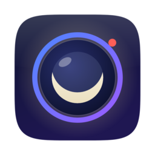
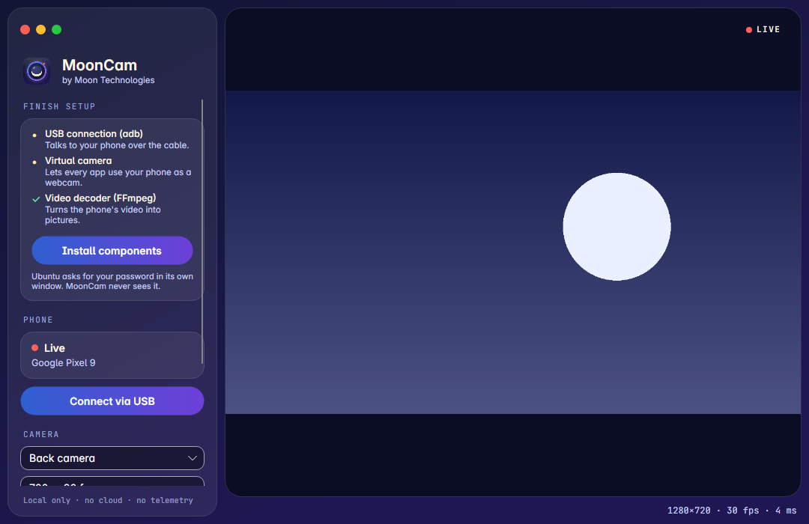
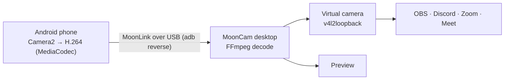

<p align="center">
  
</p>

<h1 align="center">MoonCam</h1>

<p align="center"><b>Your Android phone as a webcam and microphone for Linux.</b><br>
Local only · no cloud · no account · no telemetry</p>

<p align="center">
  
</p>

MoonCam turns an Android phone into a **real webcam** for your computer. The picture appears as a camera
called **"MoonCam"** in OBS Studio, Discord, Zoom, Google Meet, Teams and your browser — over a USB cable today,
and over Wi-Fi soon.

> **Status:** Stage 1 of 6 — USB connection and live preview work end to end. See the [roadmap](docs/roadmap.md).
> Linux (Ubuntu 26.04) and Android 10+.

## Features

- **USB connection** through ADB, with a one-time token and a consent prompt on the phone
- **Live preview** in a macOS-style window, with the Moon type family
- **Virtual camera** (v4l2loopback, Canonical-signed module: works with Secure Boot, no reboot)
- **Front, back, ultra-wide and telephoto** lenses, when the phone exposes them
- **Resolution, frame rate and quality** presets (480p–1080p, 30/60 fps)
- **Resilient**: heartbeats, automatic reconnection, frame dropping instead of growing delay
- Coming next: microphone with noise suppression, Wi-Fi pairing, phone mirroring, hand gestures

## Install (Ubuntu 26.04)

Download `mooncam_<version>_amd64.deb` from [Releases](../../releases) and open it, or:

```bash
sudo apt install ./mooncam_0.1.0_amd64.deb
```

That single step installs and configures everything MoonCam needs — the .NET runtime, FFmpeg, adb and the
signed virtual camera driver. Open MoonCam from your apps and it is ready.

On the phone, install the MoonCam app, turn on **USB debugging** (Settings → Developer options), plug in the
cable and press **Connect via USB** on the computer.

## How it works



| Read | What it covers |
|---|---|
| [Architecture](docs/architecture.md) | Components, data flow, latency budget, sync, reconnection |
| [Decisions](docs/decisions.md) | Every technology choice, with alternatives and trade-offs |
| [Protocol](docs/protocol.md) | MoonLink v1, the wire format between phone and computer |
| [Security](docs/security.md) | Threat model, pairing, consent, least privilege |
| [Research](docs/research.md) | Cameras, dual microphones, noise suppression, gestures, mirroring |
| [Engineering](docs/engineering.md) | Code standards, testing, security practices |

## Repository

```
android/      Kotlin: protocol (pure JVM) + app (Camera2, MediaCodec, Compose)
desktop/      C# / .NET 10: Core, Infrastructure, Platform.Linux, App (Avalonia 12), FakePhone tool, tests
protocol/     Shared MoonLink test vectors used by both test suites
packaging/    Debian package and the privileged setup helper
docs/         Architecture, decisions, protocol, security, research, roadmap
```

## Build and test

```bash
# Desktop (needs the .NET 10 SDK and FFmpeg)
cd desktop && dotnet test MoonCam.slnx

# Android protocol (needs JDK 17+)
cd android && ./gradlew :protocol:test

# Android app (needs the Android SDK)
cd android && ./gradlew :app:assembleDebug

# Debian package
packaging/linux/build-deb.sh 0.1.0
```

No phone at hand? `FakePhone` streams a test pattern exactly like the app does:

```bash
dotnet run --project desktop/src/MoonCam.App -- --dev-token dev-demo-token-for-testing-only-0001   # Debug builds only
dotnet run --project desktop/src/MoonCam.Tools.FakePhone -- --token dev-demo-token-for-testing-only-0001
```

## License

Code: [Apache-2.0](LICENSE). The **MoonCam** and **Moon Technologies** names and logos are trademarks and are not
covered by the license (see [NOTICE](NOTICE)). Fonts: SIL OFL 1.1.

---

## Español

**MoonCam** convierte tu teléfono Android en la **cámara web** de tu computador con Linux. La imagen aparece como
una cámara llamada **"MoonCam"** en OBS, Discord, Zoom, Meet y el navegador. Todo es local: sin nube, sin cuenta,
sin telemetría.

**Instalar:** abre el archivo `.deb` de [Releases](../../releases) (o `sudo apt install ./mooncam_0.1.0_amd64.deb`).
Ese único paso instala y configura todo lo necesario. En el teléfono activa la **depuración USB**, conecta el cable y
pulsa **Connect via USB** en el computador; el teléfono te pedirá permiso antes de transmitir.

Hecho con amor en Colombia por **Moon Technologies** — parte de Moon Open Source.
