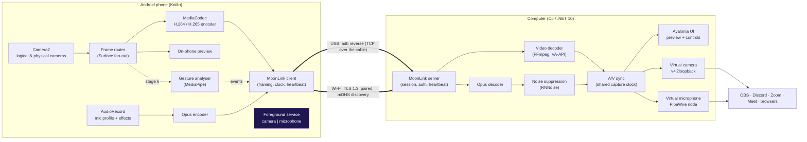

# MoonCam — Architecture

MoonCam turns an Android phone into a **webcam and microphone** for a computer. The phone captures and
encodes; the computer receives, decodes, synchronises and exposes the result as **real system devices**
(a virtual camera and a virtual microphone) that any application can use — OBS Studio, Discord, Zoom,
Google Meet, browsers.

Version 1 targets **Ubuntu 26.04 (GNOME 50, Wayland, PipeWire 1.6)**. Windows and macOS are planned; the
architecture isolates everything platform-specific behind interfaces so they can be added later.

---

## 1. Requirements

### Functional

| ID | Requirement | Stage |
|---|---|---|
| F1 | Connect over **USB (ADB)** and over **Wi-Fi** on the local network | 1 (USB), 3 (Wi-Fi) |
| F2 | Live **preview** on the computer | 1 |
| F3 | Choose **front/back** camera and extra lenses (**ultra-wide, telephoto**) when the phone exposes them | 2 |
| F4 | Configure **resolution, FPS and quality** (bitrate) | 1 (fixed presets), 2 (UI) |
| F5 | Stream the phone's **microphones**, choose the capture profile, use **noise suppression** | 3 |
| F6 | **Virtual camera** visible to all apps | 2 |
| F7 | **Virtual microphone** visible to all apps | 3 |
| F8 | **Connect / disconnect** in one click; **auto-reconnect** after interruptions | 1 (manual), 3 (auto) |
| F9 | **Audio/video synchronisation** | 3 |
| F10 | **Authorised connections only**, clear "camera/mic in use" indicators on both devices | 1 (USB token), 3 (Wi-Fi pairing) |
| F11 | **Phone mirroring**: see and control the phone with the computer's mouse while the camera keeps streaming | 5 |
| F12 | **Hand gestures** recognised by the phone to control MoonCam (mute, switch camera, reactions) | 6 |

### Non-functional

- **Latency:** glass-to-glass below 150 ms on USB and below 250 ms on a good 5 GHz Wi-Fi.
- **Stability:** a dropped connection never removes the virtual devices; apps using them keep working
  (they show a "reconnecting" frame and silence) until the phone is back.
- **Privacy:** no cloud, no account, no telemetry. Everything stays on the local network or the USB cable.
- **Quality:** clean architecture, automated tests on both platforms, documentation in English.

---

## 2. System overview



**Who does what**

- The **phone** owns the sensors: it captures, encodes with the hardware encoder and sends compressed
  data. Encoding on the phone is what makes Wi-Fi possible (raw 1080p30 would need ~750 Mbit/s).
- The **computer** owns the outputs: it decodes, keeps audio and video aligned, applies noise suppression
  and feeds the virtual devices and the preview.
- **MoonLink** is MoonCam's own small protocol between them (see [protocol.md](protocol.md)).

---

## 3. Connection model

**The phone is the client; the computer is the server.**

| Transport | How it works | Why |
|---|---|---|
| **USB** | The desktop runs `adb reverse tcp:47321 tcp:47321`. On the phone, `127.0.0.1:47321` now reaches the computer through the cable. The desktop launches the app with an explicit intent carrying a one-time session token. | No network needed, lowest latency, works on any Wi-Fi. ADB is already authorised by the user (RSA key prompt). |
| **Wi-Fi** | The desktop advertises `_mooncam._tcp` with Avahi (mDNS). The phone lists nearby computers; the user taps one; they pair once (6-digit code on both screens); afterwards they connect over TLS 1.3 with pinned certificates. | Zero configuration on the same network, no cloud, encrypted and authenticated. |

Making the phone the client means **the phone never opens a listening port**: no other device or app can
connect to the camera. The camera stream only flows towards a computer that the phone has chosen and paired
with.

The same MoonLink session code runs on both transports; only the socket setup differs.

---

## 4. Desktop architecture (C# / .NET 10)

Clean Architecture: dependencies point **inwards**, towards `Core`. `Core` has no I/O and no platform code,
so it is fully unit-testable.

```
desktop/
├─ src/
│  ├─ MoonCam.Core/              Domain + protocol. No I/O, no OS calls.
│  │  ├─ Protocol/               frame header, reader/writer, messages, preamble
│  │  ├─ Session/                connection state machine, heartbeat policy, stream settings
│  │  └─ Media/                  media frame types and sink interfaces (IVideoSink, IAudioSink)
│  ├─ MoonCam.Infrastructure/    Adapters to the outside world
│  │  ├─ Network/                MoonLink TCP server (and later TLS + mDNS)
│  │  ├─ Adb/                    adb device tracking, reverse tunnel, app launch
│  │  └─ Decoding/               FFmpeg (libavcodec/libswscale) through a minimal P/Invoke layer
│  ├─ MoonCam.Platform.Linux/    v4l2loopback virtual camera, PipeWire virtual microphone
│  ├─ MoonCam.App/               Avalonia 12 UI and composition root (wires everything)
│  └─ MoonCam.Tools.FakePhone/   development tool: streams a test video over MoonLink like a phone would
└─ tests/                        xUnit tests per project, plus shared protocol test vectors
```

Key interfaces (in `Core`):

```csharp
public interface IVideoSink { void Push(VideoFrame frame); }   // preview, virtual camera
public interface IAudioSink { void Push(AudioFrame frame); }   // virtual mic, monitor
public interface IVirtualCamera : IVideoSink, IDisposable { string DevicePath { get; } }
```

`MoonCam.App` decides which implementations to use: on Linux it plugs `V4l2LoopbackCamera`; on Windows it
will plug a Media Foundation implementation — nothing else changes.

## 5. Android architecture (Kotlin)

```
android/
├─ protocol/    Pure Kotlin (JVM) MoonLink implementation. No Android dependency → fast unit tests,
│               and the same test vectors as the desktop.
└─ app/
   ├─ capture/   Camera2 session, camera enumeration (logical/physical lenses), MediaCodec encoder,
   │             AudioRecord + Opus (stage 3)
   ├─ link/      socket client, reconnection with back-off, USB/Wi-Fi connection targets
   ├─ service/   StreamingService: foreground service (type camera|microphone) with the persistent
   │             notification and the Stop action — the stream survives when you switch apps
   └─ ui/        Jetpack Compose screens (status, camera picker, settings)
```

**Why a foreground service:** Android only lets an app use the camera and microphone while it is visible
*or* while it runs a foreground service of type `camera`/`microphone` started from the foreground. With it,
you can open another app on the phone (to read a message or approve a login) and MoonCam keeps streaming.
Android shows its own green privacy indicator plus our notification the whole time.

Limit to know: if *another* app opens the camera, Android gives it priority and MoonCam's camera is
disconnected; MoonCam shows "camera busy" and reopens it automatically when it is free again.

---

## 6. Media pipeline and latency budget

| Step | Typical cost | How we keep it low |
|---|---|---|
| Sensor → encoder | 5–15 ms | Camera writes straight into the encoder's input `Surface` (zero copy) |
| Encode (H.264 HW) | 5–15 ms | No B-frames, realtime priority, short GOP, on-demand key frames |
| Transport USB / Wi-Fi | 2–5 ms / 5–40 ms | `TCP_NODELAY`, small socket buffers, sender drops frames instead of queueing |
| Decode | 3–10 ms | FFmpeg with `low_delay`, VA-API on the AMD GPU when available |
| Write to virtual camera | < 2 ms | I420 straight from the decoder, no colour conversion |
| Consumer app (Zoom, Meet…) | 30–60 ms | outside our control |

**Back-pressure rule:** video is never queued on the phone. If the socket is busy when a new frame is ready,
the frame is dropped and the next key frame is requested. Old video is worse than missing video.

## 7. Audio/video synchronisation

Both streams are stamped on the **phone** with the same clock (`CLOCK_BOOTTIME`): camera frames use the
sensor timestamp, audio uses `AudioRecord.getTimestamp`. The desktop never re-stamps; it measures how late
each stream arrives and **delays the earlier one** (usually audio) by the difference, inside a small jitter
buffer (target 40 ms, adaptive). A manual offset slider covers devices with odd latencies.

## 8. Resilience and reconnection

- **Heartbeat:** the desktop sends `PING` every second; 3 s of silence means the link is lost.
- **Phone side:** exponential back-off (0.5 s → 8 s) while the service is running.
- **Desktop side:** the virtual camera keeps receiving a "Reconnecting…" frame and the virtual mic keeps
  receiving silence, so meeting apps never lose the device.
- **After reconnecting:** the desktop asks for a key frame so the picture comes back immediately.

## 9. Security

Summary (details in [security.md](security.md)):

- No cloud. USB uses the already-authorised ADB channel; Wi-Fi uses TLS 1.3 with certificate pinning after
  a one-time pairing with a 6-digit code shown on both screens.
- The phone never listens for connections. The desktop accepts unpaired Wi-Fi connections only while the user
  has the pairing window open.
- Indicators: Android's system indicator + MoonCam's persistent notification (with Stop) on the phone; a red
  **LIVE** badge and tray state on the computer.

## 10. Cross-platform plan

| | Linux (v1) | Windows (later) | macOS (later) |
|---|---|---|---|
| UI | Avalonia | Avalonia | Avalonia |
| Virtual camera | v4l2loopback | Media Foundation virtual camera (Windows 11, `MFCreateVirtualCamera`) | CoreMediaIO Camera Extension (Swift, signed & notarised) |
| Virtual microphone | PipeWire node | virtual audio driver (signed) or integration with an existing one | Audio Server plug-in (HAL) |
| Decoding | FFmpeg + VA-API | FFmpeg + D3D11VA | VideoToolbox |
| USB | adb | adb | adb |

Everything in the table lives in `MoonCam.Platform.<OS>` projects behind the `Core` interfaces.

## 11. Technology decisions

Each choice is justified — with alternatives and trade-offs — in [decisions.md](decisions.md).
