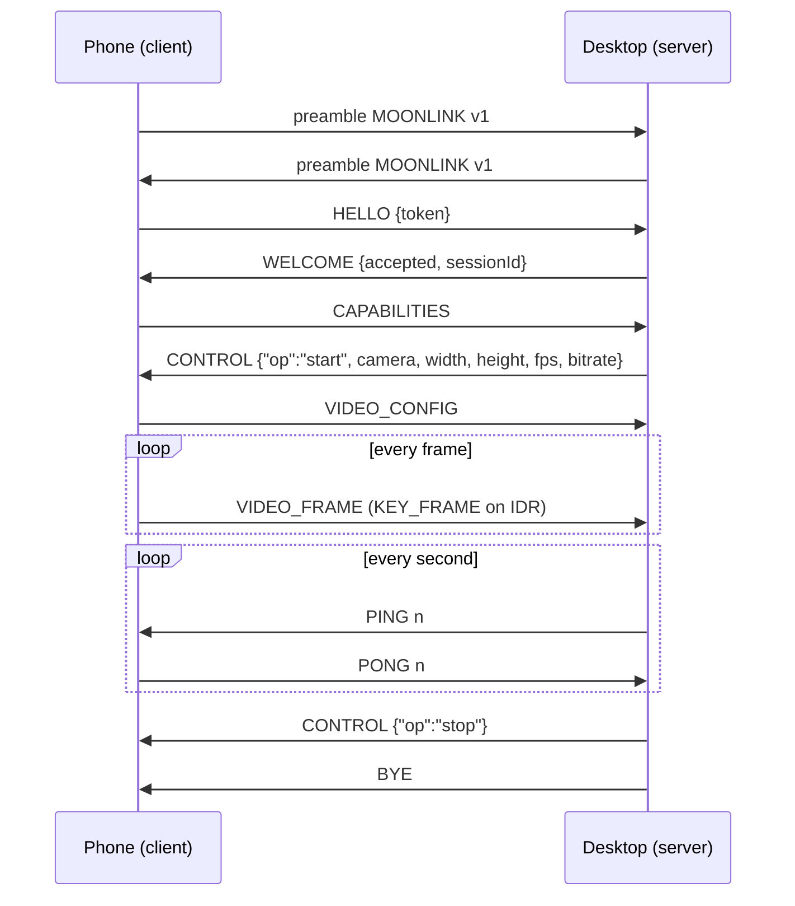
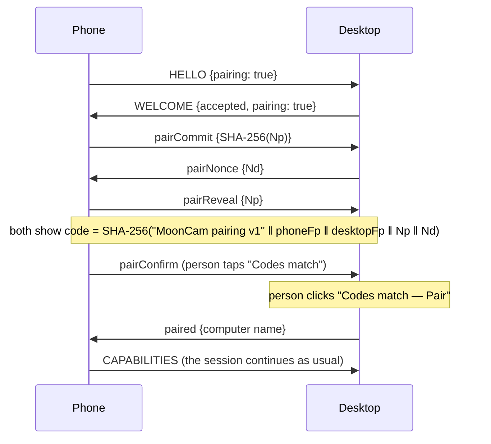

# MoonLink v1 — wire protocol

MoonLink is the protocol between the MoonCam phone app (client) and the MoonCam desktop app (server).
It is deliberately small: a fixed preamble, then a stream of length-prefixed frames.
All integers are **big-endian** (network order).

Two transports carry the same bytes; the phone is always the client.

| Transport | Desktop listens on | Who proves what |
|---|---|---|
| **USB** | `127.0.0.1:47321/tcp`, reached through `adb reverse` | The desktop passes a one-time token to the phone through ADB; the phone sends it back in `HELLO` |
| **Wi-Fi** | `0.0.0.0:47322/tcp`, **TLS 1.3 only** | Both sides present a self-signed certificate (client certificate required). Each side identifies the other by the SHA-256 fingerprint of its certificate, learned once by pairing (§7) |

**Discovery.** Only on networks the person trusts (docs/security.md), the desktop announces itself with mDNS (Avahi) as service type `_mooncam._tcp`, instance name
`MoonCam on <hostname>`, port 47322 and TXT records `v=1` and `fp=<first 16 hex digits of its certificate
fingerprint>`. The phone uses `fp` only to recognise computers it already paired with; the announcement is not
trusted for anything else, because TLS proves the identity afterwards.

Shared test vectors live in [`protocol/test-vectors/`](../protocol/test-vectors): both the Kotlin and the C#
test suites decode and re-encode them, so the two implementations cannot drift apart.

## 1. Preamble

The client opens the connection with 10 bytes:

| Offset | Size | Value |
|---|---|---|
| 0 | 8 | ASCII `MOONLINK` |
| 8 | 2 | protocol version, `u16` = `1` |

The server answers with the same 10 bytes carrying the version it will speak (`1`), or closes the connection
if it does not support the client's version. This rejects port scanners and stray clients in one read.

## 2. Frame

Every message after the preamble is a frame: a **16-byte header** followed by `length` bytes of payload.

| Offset | Size | Field | Notes |
|---|---|---|---|
| 0 | 1 | `type` | see table below |
| 1 | 1 | `flags` | bit 0 `KEY_FRAME`, bit 1 `END_OF_STREAM`; other bits must be 0 |
| 2 | 2 | `reserved` | must be 0 |
| 4 | 4 | `length` | payload size, `u32`, at most **16 MiB** |
| 8 | 8 | `timestamp` | `i64` microseconds on the sender's monotonic clock (`CLOCK_BOOTTIME` on Android); 0 when not meaningful |

A receiver must close the connection on an unknown `type`, a non-zero reserved field or a length above the
limit: being strict keeps both sides honest and makes bugs visible.

## 3. Message types

| Type | Name | Direction | Payload |
|---|---|---|---|
| `0x01` | `HELLO` | phone → desktop | JSON: who the phone is, plus the session token |
| `0x02` | `WELCOME` | desktop → phone | JSON: accepted or rejected, session id |
| `0x03` | `CAPABILITIES` | phone → desktop | JSON: cameras (with lenses, sizes, fps), microphones |
| `0x04` | `CONTROL` | both | JSON command or event (see §5) |
| `0x10` | `VIDEO_CONFIG` | phone → desktop | binary: codec, size, codec-specific data |
| `0x11` | `VIDEO_FRAME` | phone → desktop | one encoded access unit (Annex-B for H.264/H.265) |
| `0x20` | `AUDIO_CONFIG` | phone → desktop | binary: codec, sample rate, channels, codec-specific data |
| `0x21` | `AUDIO_FRAME` | phone → desktop | one encoded audio packet |
| `0x30` | `PING` | desktop → phone | 8 bytes: `u64` nonce |
| `0x31` | `PONG` | phone → desktop | the same 8 bytes |
| `0x3F` | `BYE` | both | JSON: `{ "reason": "..." }`, then the sender closes |

### `HELLO`

```json
{ "deviceName": "Pixel 9", "manufacturer": "Google", "model": "Pixel 9",
  "androidVersion": "16", "appVersion": "0.1.0", "token": "base64url-session-token" }
```

### `WELCOME`

```json
{ "accepted": true, "sessionId": "8f6c…", "serverName": "Lenovo-V14", "reason": null }
```

When `accepted` is `false` the desktop sends `WELCOME`, then `BYE`, then closes.

### `VIDEO_CONFIG`

| Size | Field |
|---|---|
| 1 | codec: `1` H.264, `2` H.265 |
| 2 | width (`u16`) |
| 2 | height (`u16`) |
| 1 | frames per second (`u8`) |
| rest | codec-specific data: Annex-B SPS (+VPS) and PPS |

A new `VIDEO_CONFIG` may arrive at any time (camera or resolution changed); the receiver resets its decoder.

### `AUDIO_CONFIG`

| Size | Field |
|---|---|
| 1 | codec: `1` Opus, `2` PCM signed 16-bit little-endian |
| 4 | sample rate (`u32`) |
| 1 | channels (`u8`) |
| rest | codec-specific data (`OpusHead` for Opus, empty for PCM) |

## 4. Session



**Video on demand:** the desktop sends `start` only while someone can see the picture (the MoonCam window is
on screen, or another app has the virtual camera open) and `stop` about 4 seconds after the last viewer leaves.
The phone closes its camera and encoder on `stop`, so neither device works while nobody watches; the session
itself stays open and resumes in about a second.

**Goodbye is final:** a `BYE` from the desktop (Disconnect, unpair, or MoonCam closing) ends the link for good:
the phone does not reconnect on its own. A connection that simply drops (Wi-Fi lost, cable pulled) is retried.

**Liveness:** the desktop sends `PING` every second. If either side receives nothing for **3 seconds** it
considers the connection lost. The phone reconnects with exponential back-off (0.5 s doubling to 8 s).

## 5. Control messages

`CONTROL` payloads are JSON objects with an `op` field.

| `op` | Direction | Fields | Meaning |
|---|---|---|---|
| `start` | desktop → phone | `camera`, `width`, `height`, `fps`, `bitrateBps`, `codec` | start (or restart) streaming |
| `stop` | desktop → phone | — | stop streaming, keep the session |
| `keyFrame` | desktop → phone | — | send an IDR as soon as possible |
| `status` | phone → desktop | `streaming`, `camera`, `message` | state changes, e.g. "camera busy" |
| `pairCommit` | phone → desktop | `data` = base64 SHA-256 of the phone's 32-byte nonce | pairing step 1 (§7) |
| `pairNonce` | desktop → phone | `data` = base64 desktop nonce (32 bytes) | pairing step 2 |
| `pairReveal` | phone → desktop | `data` = base64 phone nonce | pairing step 3; must match the commitment |
| `pairConfirm` | phone → desktop | — | the person on the phone saw the same code |
| `paired` | desktop → phone | `message` = computer name | both people confirmed; the phone is trusted from now on |
| `unpair` | either way | — | the sender no longer trusts the receiver; the receiver forgets the sender too, then the desktop says `BYE` |

Unknown `op` values are ignored (forward compatibility); unknown frame **types** are not.

## 6. Versioning

The preamble version changes only for incompatible changes. New `CONTROL` operations and new optional JSON
fields are compatible changes and do not bump the version.

## 7. Wi-Fi pairing

A phone that is not paired yet sends `HELLO` with `"pairing": true`. The desktop accepts it only while the
person has pairing open on the computer ("Pair over Wi-Fi", 2 minutes, at most 5 attempts, one phone at a
time) and answers `WELCOME` with `"pairing": true`. Until `paired`, the desktop ignores media and sends no
commands.



The code is the first 4 bytes of the hash, big-endian, modulo 10⁶, shown as six digits (`482 913`). The phone
commits to its nonce before it sees the desktop's, so a man in the middle, who would present different
certificates to each side, cannot pick nonces that make the two codes equal (1 chance in a million per try,
and tries are limited). A `BYE` during pairing means the desktop cancelled it. The shared vector
`pairing` in `protocol/test-vectors/moonlink-v1.json` fixes the computation for both implementations.
